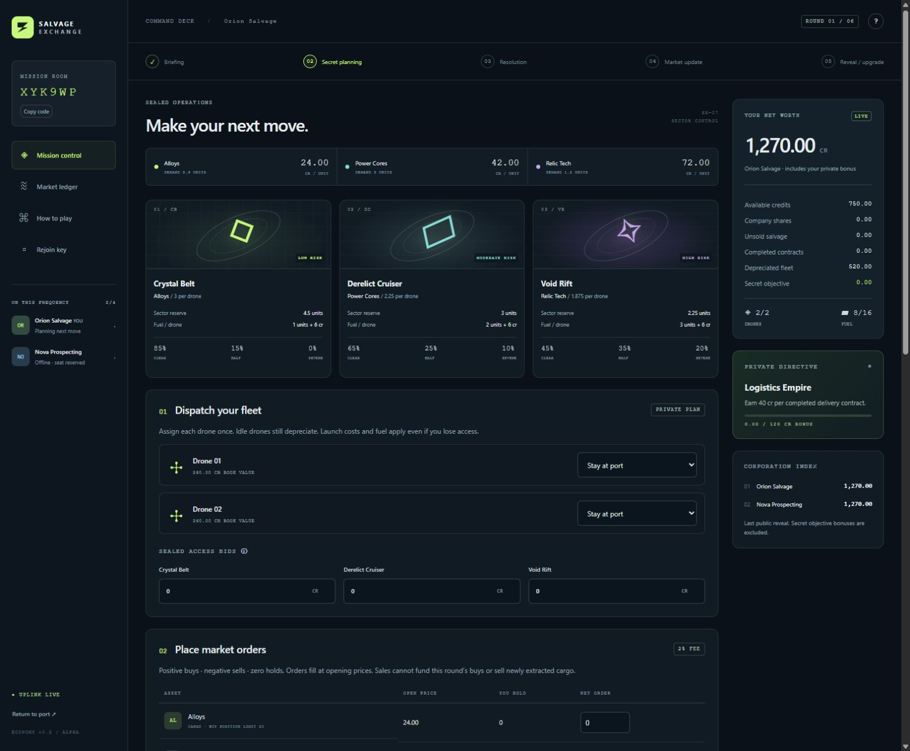

# SALVAGE EXCHANGE

Crack the wreck. Play the market. A server-authoritative browser game for **2–4 players over six rounds**, with private plans, finite salvage reserves, commodity and stock markets, and persistent room-code lobbies.

**Step 3 implementation is on `codex/multiplayer-build`. The UI polish pass in [docs/UI_POLISH_REPORT.md](docs/UI_POLISH_REPORT.md) builds on it. Step 4 sections C–F and Step 5 deployment are pending. No public URL exists yet.**



## Run locally

Prerequisites: Python **3.12+**, Node.js **22+**, and a writable local disk. Node only checks and packages browser assets; there are no npm dependencies. Use a normal Python installation with pip/venv support.

Windows PowerShell:

```powershell
git clone --branch codex/multiplayer-build https://github.com/SamIzOP/Salvage-Exchange.git
Set-Location Salvage-Exchange
python -m venv .venv
.\.venv\Scripts\python.exe -m pip install -r requirements.txt
node scripts/build.mjs
.\.venv\Scripts\python.exe -m uvicorn server.app:app --host 127.0.0.1 --port 8000
```

macOS/Linux:

```sh
git clone --branch codex/multiplayer-build https://github.com/SamIzOP/Salvage-Exchange.git
cd Salvage-Exchange
python3 -m venv .venv
.venv/bin/python -m pip install -r requirements.txt
node scripts/build.mjs
.venv/bin/python -m uvicorn server.app:app --host 127.0.0.1 --port 8000
```

Open **http://127.0.0.1:8000**. Create a room and share its six-character code. Other players must reach the same running server; localhost is only reachable on its own computer. Use separate browser profiles for separate players. The host starts when 2–4 players join. Real devices need the eventual HTTPS deployment or a trusted local HTTPS development proxy: Web Crypto requires a secure context (localhost is trusted by browsers).

The app serves `dist/` if present, otherwise `web/`. Rebuild after frontend edits. Rooms persist in `data/rooms.sqlite3`; restarting preserves seats, scans, locks and receipts. The landing page lists saved rooms. **Rejoin key** provides your private key for restoring your corporation on another browser. Never share it with rivals.

## How to play

Read public demand and hazard odds, optionally buy private scans and fuel, then acknowledge briefing. Secretly send drones, bid for extraction, choose Buy / Sell / Hold market orders and request delivery contracts, then review and lock. Everyone locks before trades, hazards, salvage and market prices resolve together. Inspect the reveal, upgrade, and acknowledge to continue. After six rounds, credits, shares, cargo, contracts, depreciated fleet and your secret objective determine the winner. Contracts award score, not cash. Sabotage, short selling and loans remain future expansions.

## Configuration

See [`.env.example`](.env.example). **Export variables or configure them in the host; the app does not automatically load `.env`.** No application-wide secret is required: identity uses per-player random bearer keys stored hashed by the server.

| Variable | Default | Purpose |
|---|---|---|
| `SALVAGE_DB` | `data/rooms.sqlite3` | Persistent SQLite path outside public assets |
| `ALLOWED_ORIGINS` | localhost/127.0.0.1:8000 and testserver | Comma-separated exact browser origins |
| `ALLOWED_HOSTS` | localhost,127.0.0.1,testserver | Comma-separated hostnames |

PowerShell example: `$env:SALVAGE_DB = 'C:\salvage-data\rooms.sqlite3'`. On Unix use `export SALVAGE_DB=/data/rooms.sqlite3`.

## Implementation checks

Use the virtual environment's Python (`.venv\Scripts\python.exe` on Windows; `.venv/bin/python` on Unix):

```sh
python simulation/test_economy.py
python -m unittest discover -s tests -v
node --test tests/client.test.mjs tests/model.test.mjs
node scripts/build.mjs
```

The original 32 economy checks and new server/HTTP/preview/persistence/concurrency/replay/client regressions are separate from a full browser match. Replay tests regenerate all saved 2/3/4-player fixtures without editing them. See [build report](docs/STEP3_BUILD_REPORT.md).


Browser checks drive the real UI with Playwright against a local server: a six-round two-identity match, interaction states, a layout sweep and a four-crew room. See [tests/browser/README.md](tests/browser/README.md).

`npm run test:worker` checks that the Workers port below matches the Python server exactly (it runs the Python reference, so use the virtual environment's dependencies).

## ChatGPT Sites and other Workers hosts

ChatGPT Sites can't run the Python server, so `worker/` contains a Workers + D1 port of it that serves the same browser client. Run it locally with `npm install` then `npm run worker:dev` (http://127.0.0.1:8787). See [docs/SITES_DEPLOYMENT.md](docs/SITES_DEPLOYMENT.md) for deployment steps, differences from the Python server and how parity is verified. It is verified in Cloudflare's local Workers runtime only; it has not been deployed to ChatGPT Sites.

## Deployment prerequisites — Step 5 only

- Finish Step 4 first.
- A real Python backend, persistent local volume, HTTPS reverse proxy, configured allowed origin/host and health monitoring. Static hosting alone cannot run this game.
- One service/host, initially one Uvicorn worker. Do not distribute SQLite files across machines. Horizontal scaling needs a transactional shared database and distributed throttling.
- Keep database/backups private; restrict filesystem permissions. The volume must be writable by the runtime user (Docker UID 10001). Use SQLite's online backup API, or stop the service before copying database/WAL files together. Ephemeral disks lose rooms.
- Proxy body/time limits, edge rate limiting, correct trusted-proxy configuration and secret-free logs. The app already provides bounded input, origin checks, bearer authentication and CSP.
- Dockerfile supplied: mount a persistent volume at `/data` and set production `ALLOWED_ORIGINS` / `ALLOWED_HOSTS`. Include `127.0.0.1` in allowed hosts for its healthcheck. Docker packaging has not been built or deployed in Step 3.
- No automatic room expiration, admin dashboard, host takeover, spectators or email recovery. Disconnected seats wait for their owner; lost keys cannot be recovered by name or room code.

A future container build uses `docker build -t salvage-exchange .`. Configure environment and storage before running. This is documentation, not a record of deployment.

## Rules and balance limits

- [Project brief](PROJECT_BRIEF.md), [frozen v0.2 economy](ECONOMY.md), [balance report](BALANCE_REPORT.md), [sprint status](SPRINT_STATUS.md).
- [Architecture](docs/ARCHITECTURE.md), [build plan](docs/STEP3_PLAN.md), [simulator](simulation/README.md).

The mixed-strategy four-player bot benchmark meets its stated target; the economy is **not universally balanced**. A lone extractor strongly counters three pure traders; pure trading is weak in two-player games. Logistics objectives underperform with these bots, automatic two-scan buying is not reliably profitable, and bounded final-price marking incentives remain. Frozen simulation parameters/results are preserved unchanged.
