# Art direction: an inhabited orbital salvage yard

The earlier "restrained clinical console" direction produced reliable, readable controls but little character: dark outlined panels, line drawings, pills and paragraphs everywhere. This revision keeps the controls and state handling and gives the game a place: a salvage yard in orbit, with a dock at its edge and three wrecks across the field. One illustrated scene is the dominant visual on the start screen, in briefing and planning, in the reveal and on the results screen.

## Two studies of the same planning state

Both studies use the same real practice state: round 1 planning, Drone 1 sent to the Belt, Drone 2 to the Cruiser, the Rift scanned as severe, real prices and costs. The sources are in `docs/art/studies/`.

| Study A: yard horizon | Study B: dispatch chart |
|---|---|
| 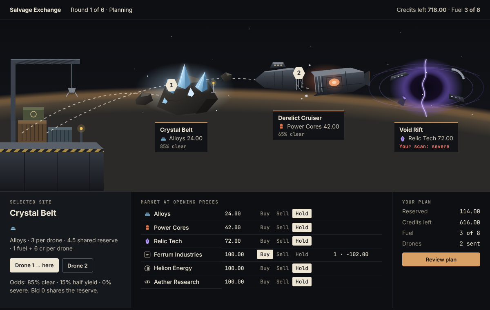 | 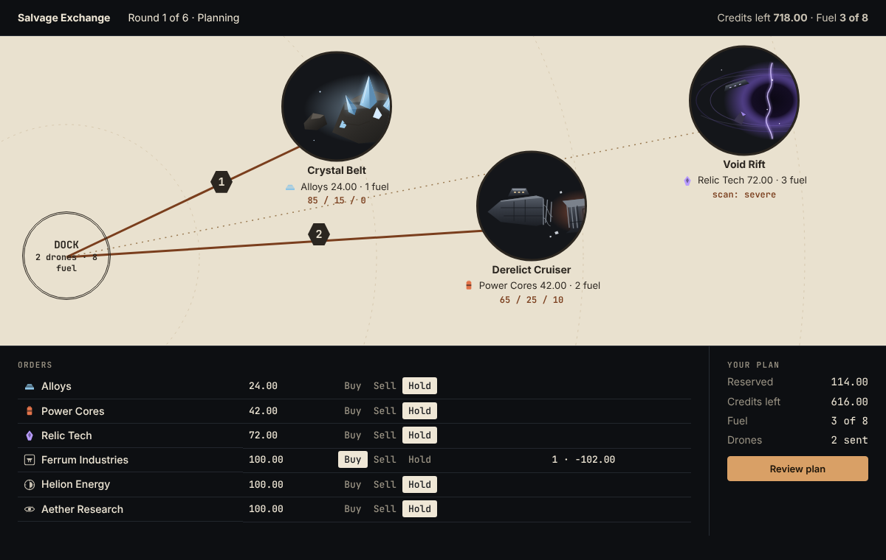 |
| A side-on yard: the dock with crane, containers and numbered pads on the left; the three sites across the field at their own depths; routes arcing out to numbered drone tokens. | A cream printed chart: the dock as a ring, sites as circular vignettes, straight route legs with fuel labels. |

**Chosen: Study A.** It reads as a place before any text does, so the game is recognisable without its title. It also gives the reveal something physical to animate: drones fly the routes, and cargo comes back to the same dock. Study B is legible and unusual, but it's a diagram. The cream surface dominates the screen, the site art is cropped into small discs that lose scale, and on a phone it would shrink into an unreadable miniature.

**What A borrowed from B:** solid, coloured routes for committed drones and a dedicated numbers view (the "Numbers" toggle) for players who plan from figures.

## The visual system

- **Light and perspective.** One key light from the upper left, a consistent three-quarter side view, and a planet limb low across the field for tonal range, so the scene isn't uniformly dark.
- **Palette.**
  - Surfaces are charcoal and steel: `--bg #0d0f12`, `--surface #15181d`, `--raised #1c2026`.
  - Text is cream (`#efe7d6`).
  - Primary actions, the mission panel and the highlighted control use copper (`#dba468`).
  - Signal colours are restrained: green `#7fd894`, red `#ff8a7a`, amber `#f2c25c`.
  - Each site keeps a single identity tint: Belt ice `#8ec5e6`, Cruiser reactor `#ec8559`, Rift violet `#b99cff`.
  - Text sits on calm, flat surfaces.
- **Sites.** Each site has its own environment in the same style:
  - **Crystal Belt:** fractured basalt split by lit mineral, with a claim beacon.
  - **Derelict Cruiser:** a hull snapped in two, ribs bare at the break, the reactor still faintly lit.
  - **Void Rift:** a tear bending light, with broken relic segments caught at its edge.
- **Cargo by form, not only colour:**
  - **Alloys:** a stack of ingots.
  - **Power Cores:** a capped cell with a charge band.
  - **Relic Tech:** an angular etched shard.
- **One drone family.** A squat salvage hull with side thrusters and a grapple. On the board, drones are numbered hexagonal tokens, copper once sent; rivals are round tokens with their initial.
- **Company insignia.** Ferrum's anvil bar, Helion's split sun and Aether's ringed eye mark the share rows.
- **Mentor.** Vale, the yard dispatcher, is shown with an emblem rather than a portrait: a signal mast inside a docking ring. The voice is restrained, with no praise loops and two sentences at most.
- **Type.** The existing self-hosted Inter and JetBrains Mono. Small uppercase mono kickers give mission titles and labels a stencilled, industrial note; no new fonts.
- **Less card chrome.** Fewer bordered rounded boxes. Tonal panels and hairlines separate content; the field's site columns sit flush beneath their sites.

## Where it appears

| Screen | Treatment |
|---|---|
| Start | Headline, then "Learn by playing" beside the create/join form, then the full-width yard as the hero. On phones the yard is a short decorative band. |
| Briefing and planning | **Wide screens:** the yard with the dock and three sites; numbered drone tokens move along routes as you assign them. Under it, a dock column and one column of real controls per site (odds, scan, drone buttons, bid), aligned with its site. **Phones** (the field narrower than 760 px): no miniature map; the dock and each site become full-width views with a banner illustration. **Numbers:** a comparison table. Market orders are compact single rows with cargo forms and insignia. |
| Reveal | The settled round played out on the yard in settlement order. See Motion. |
| Missions | Inline copper-edged panel with Vale's emblem, plus a callout beside the highlighted control. |
| Results | The yard with a "yard ledger closed" plaque naming the winner, above the final standings. |

## Motion and sound

- **Reveal.** Using only the public record, about 3 seconds in true settlement order:
  1. Drones fly out (yours from the dock, rivals' from off-field).
  2. Contested access is labelled.
  3. Hazards land; a severe site darkens and a disabled drone turns red.
  4. Cargo crates fly back to the dock.
  5. Each site's price move appears.
- **Accounting.** The reconciliation table and the numbered text steps carry the same facts.
- **Controls.** Skip and Replay. With reduced motion everything is shown in its final state, with the same text. Live state never waits for playback.
- **Count-ups.** The reveal headline and net worth count to the exact settled value and are presentation only.
- **Small motion.** Assigning a drone draws its route once and lifts the token into place. Nothing loops.
- **Sound.** Optional cues for dispatch, scan, lock, hazard, docking and settlement, synthesised in the browser with Web Audio. They're off by default (Menu → Sound cues), and nothing plays before the player turns them on.

## Asset origins and licences

All artwork is original SVG written for this repository in `web/scene.js`, plus small interface icons in `web/art.js`. That covers the sites, yard, drone glyph, cargo forms, insignia and dispatcher emblem. Sound is generated at runtime; there are no audio files. Fonts are the existing self-hosted Inter and JetBrains Mono, both under the SIL Open Font License, with licence files in `web/fonts/`. No third-party images, icon packs, paid assets or subscriptions are used, and nothing at runtime depends on an outside service.

MagicPath, Figma and Canva weren't available to this session: Figma's connector failed to connect, and the others weren't installed. The studies and art were made locally with SVG, HTML and CSS. No Kenney or other external asset packs were downloaded.

## Before and after

| | Before (`a8b2937`) | After |
|---|---|---|
| Start, desktop | 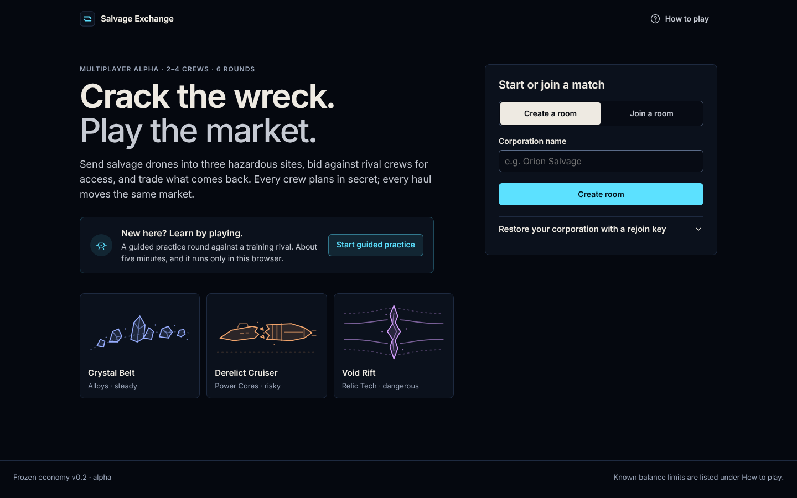 | 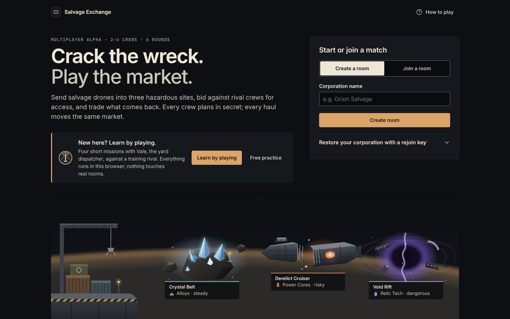 |
| Start, phone | 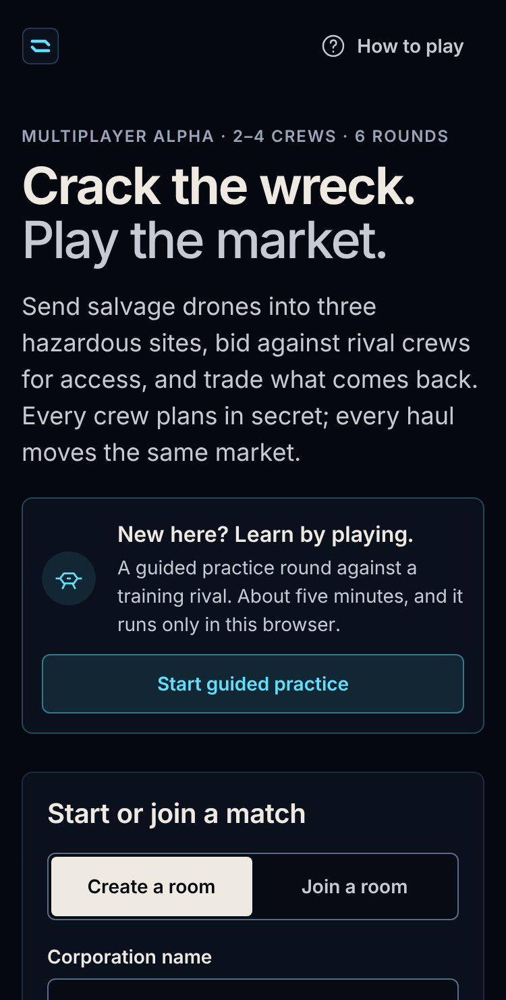 | 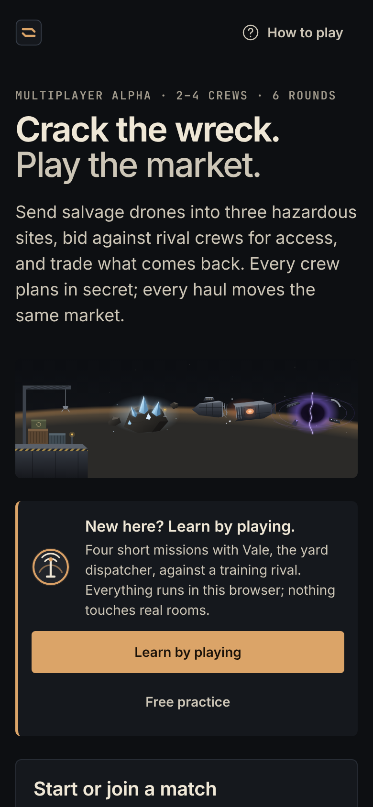 |
| Planning, desktop | 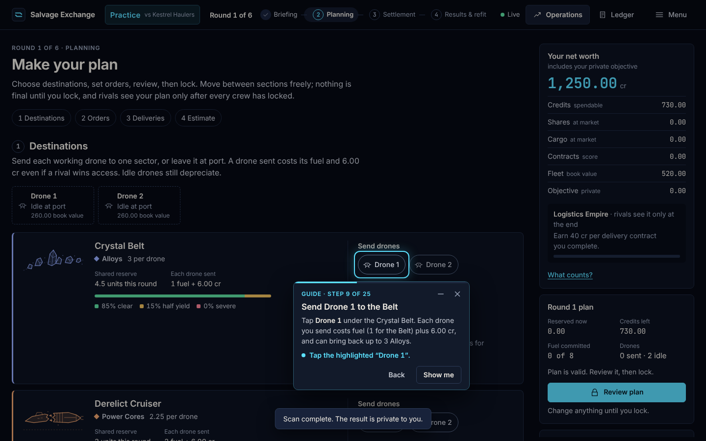 | 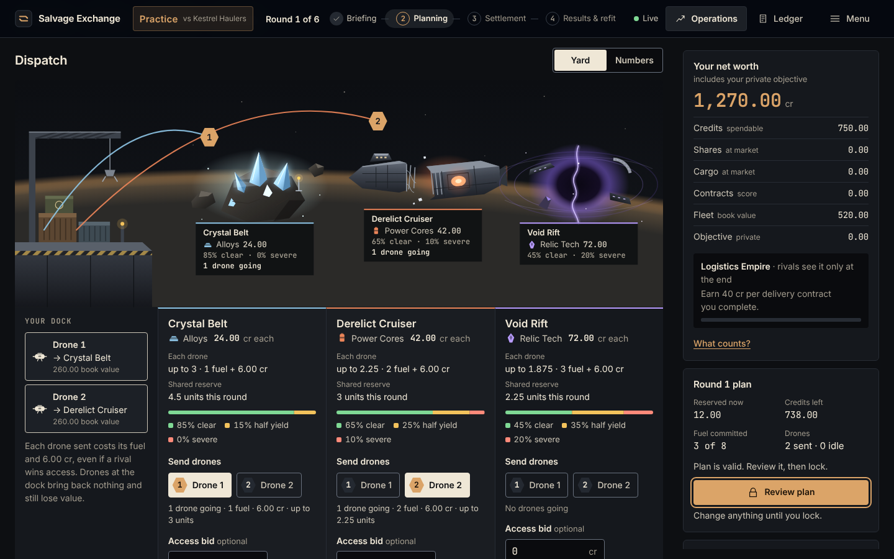 |
| Guidance, phone | 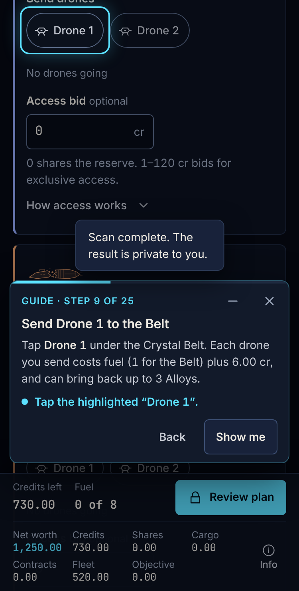 | 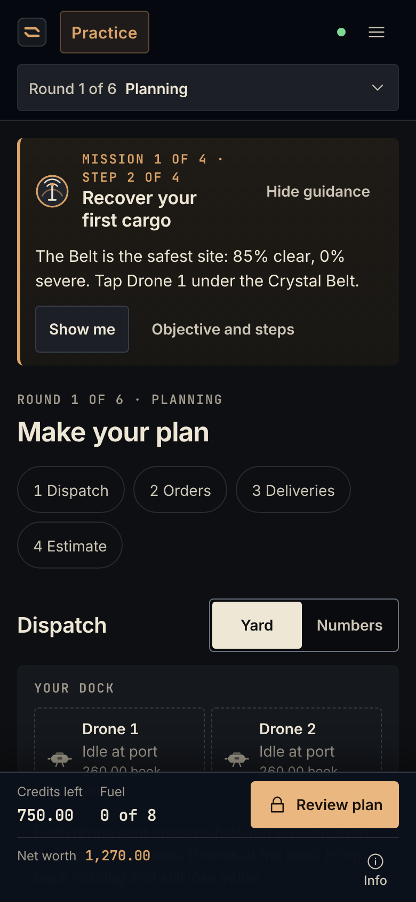 |
| Result, desktop | 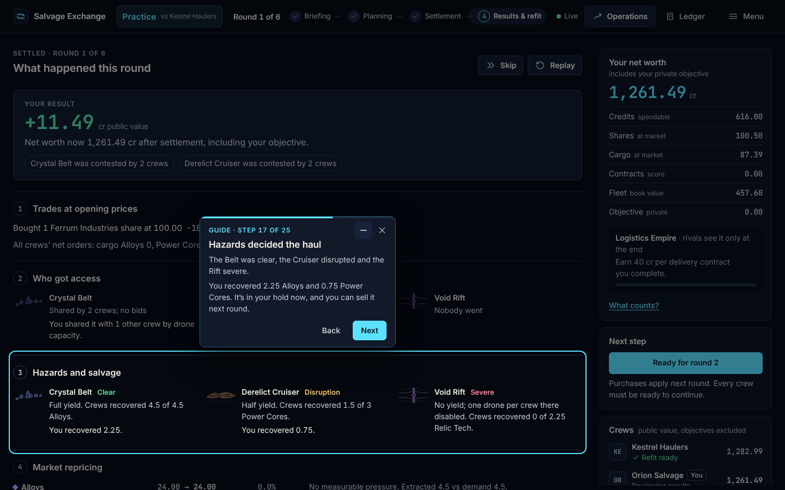 | 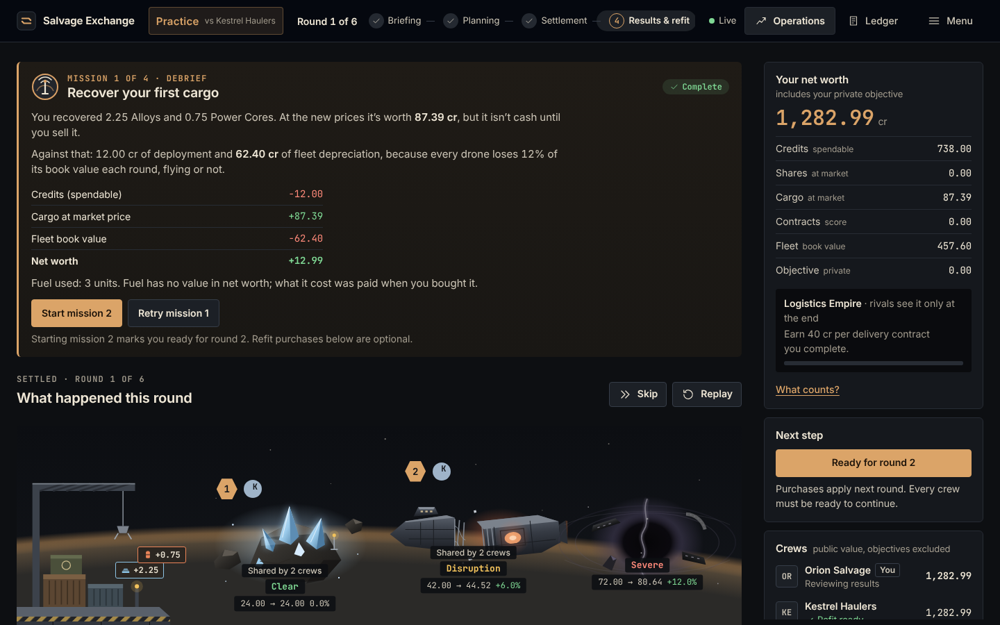 |
| Result, phone | 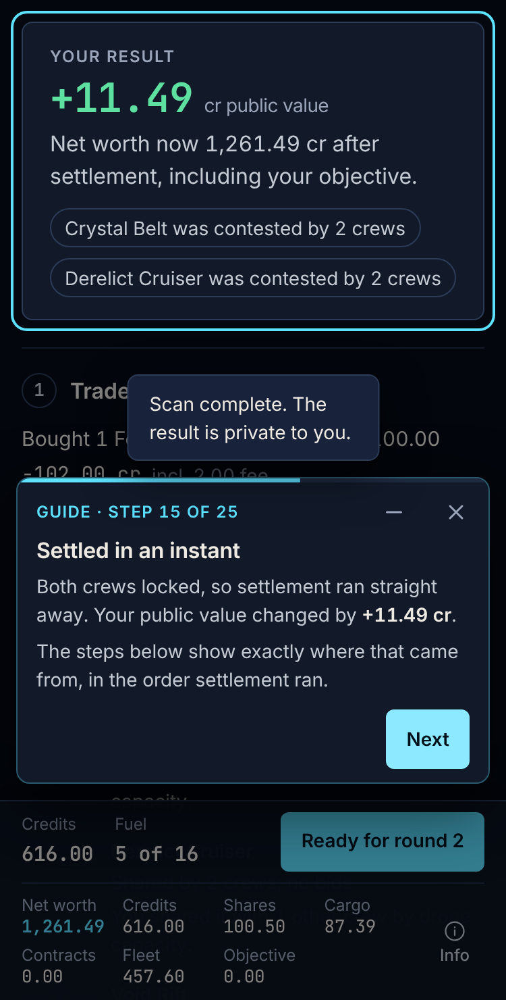 | 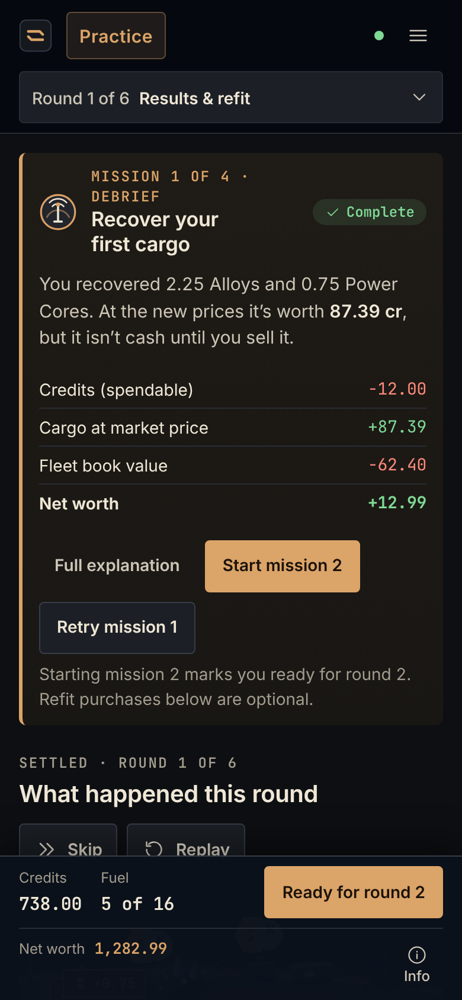 |

Also: [the reveal on the yard](screenshots/art-direction/after-reveal-desktop.png), [refit](screenshots/art-direction/after-refit-desktop.png), [final results](screenshots/art-direction/after-final-desktop.png) and [Show me on a phone](screenshots/art-direction/after-guidance-control-phone.png). The before and after captures use the same real practice content.

## Visual quality, judged separately from the tests

The tests show the layout holds: no overflow, touch targets of at least 44 px, compact phone panels, and controls reachable by keyboard. They can't show whether it looks good. My own assessment:

- **Better:** the start, planning and reveal screens now look like this game rather than a dashboard. The yard gives scale and focus, the three sites are distinct in silhouette and light, and the reveal finally shows drones and cargo moving.
- **Still weak:**
  - The illustrations are flat-shaded vector work without texture. The dock, crane and containers are simple, and the planet limb is a gradient.
  - Rival crews have no visual identity beyond a coloured initial.
  - The refit, ledger and lobby screens only received the new palette and drone glyphs; they're still text-led.
  - On mid-width desktops (1024–1240 px) the site columns under the yard get narrow.

  A dedicated illustrator pass, rival insignia and a designed refit screen would be the next steps.
