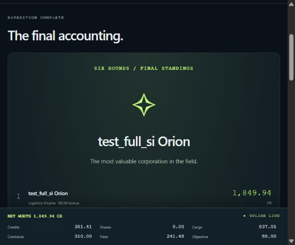

# SALVAGE EXCHANGE — QA stage A–B

Date: 27 October 2026 (Asia/Karachi). Tested implementation: `3c6399d7aff3d7f1d22b71c9ab433c4278fe9e11`, fetched from `codex/multiplayer-build`. QA branch: `qa-fixes`.

## Hidden-information findings — highest priority

**No hidden-information leak was found in the tested local HTTP responses.** Current opponents' plans, allocations, bids, orders, scans, and objectives were absent from unauthorized projections. Opponent scan purchases and a sealed plan did not change the other player's estimate. Plans became visible only after both players locked; objectives stayed private through round reveals and became public at the final standings.

Forged player/seat identifiers, missing or guessed bearer keys, cross-room credentials, and attempts to submit balances, prices, hidden outcomes, or a forced resolution were rejected. The authoritative database's prices, outcomes, balances, plans, phase, and round remained unchanged after those attacks.

This is a bounded local API review, not a claim that every possible vulnerability has been excluded. The application uses HTTP polling, not WebSockets; the evidence is captured HTTP request/response traffic. Real production configuration, browser-origin attack scenarios, concurrent stress, and device behavior were not audited in this stage.

## Stage status

| Section | Result | Evidence / limit |
|---|---|---|
| A — Full two-player smoke match | PASS locally, with one cosmetic observation | Two independent HTTP clients played all six rounds; final totals independently recomputed; actual browser displayed the correct winner. |
| B — Hidden information and authority | PASS for tested cases | Six HTTP security tests; no current rival secrets leaked; impersonation and state tampering rejected without mutation. |
| C — Rules and economy | NOT RUN | Deferred until the user says “continue”; the smoke match's final accounting does not substitute for the extreme-input economy audit. |
| D — Edge cases and robustness | NOT RUN | Deferred; no timeout, concurrent retry, refresh-every-phase, full-room, or disconnect-mid-round campaign performed. |
| E — Balance rerun and exploits | NOT RUN | Deferred; earlier simulation results are historical evidence, not a rerun against this checkout. |
| F — UI and usability | NOT RUN | Deferred; the final-screen check is not a 375px/desktop layout or first-time-user audit. |
| Live deployment comparison | BLOCKED | The supplied link is the GitHub repository, not a deployed app. The implementation README also states that no public deployment exists yet. |

## Setup and startup

The remote default branch still contains the economy-only snapshot. A fresh clone explicitly selected `codex/multiplayer-build`, then created `qa-fixes`. The build README, architecture, build report, sprint status, project brief, and frozen economy were read before testing.

Environment: Windows, Python 3.12, Node.js 24.18.0. Installed exactly the pinned `requirements.txt` in an isolated `.venv`; `pip check` reported **No broken requirements found**. There are no npm dependencies. `node scripts/build.mjs` successfully built the browser assets and passed JavaScript syntax checks.

Two environment errors occurred, neither requiring an application change:

1. Sandboxed virtual-environment bootstrapping failed: `Command ... python.exe -m ensurepip --upgrade --default-pip returned non-zero exit status 1`. Running ensurepip directly exposed `PermissionError: [Errno 13] Permission denied` writing its temporary `pip-25.0.1-py3-none-any.whl` under the Windows sandbox temp directory. Approved installation outside that sandbox completed successfully.
2. The sandboxed network test attempt ran zero tests because both servers failed readiness with `RuntimeError: Local server did not become healthy in 20 seconds`. Repeating the same tests with approved local process/socket access passed all seven tests. No server configuration or security checks were weakened.

Each test class launches a real Uvicorn process bound only to loopback, with a separate SQLite database and random port. The two clients have separate HTTP client instances and independent 256-bit bearer keys. No service method, offline simulator, direct database modification, or seeded dice shortcut was used to advance the full match.

## A — Six-round match results

Starting resources were confirmed for both clients: 750 credits, two drones, eight fuel, empty inventories and stock holdings. The match exercised briefing acknowledgements, private scans, fuel purchases, nonempty sealed allocations and bids, opening-price stock purchases and later sales, market estimates, extraction, contract delivery, repairs when needed, scanner purchase, insurance, and each upgrade acknowledgement. Round 6 went directly to `finished`.

The first lock in every round left the room in planning with no current-round reveal. Only the second lock produced the next history entry. The final history contained exactly rounds 1–6, in order, and both clients received identical final public standings and history.

| Final score component | Orion | Nova |
|---|---:|---:|
| Credits | 381.41 | 421.04 |
| Company stock | 0.00 | 0.00 |
| Unsold salvage | 837.05 | 471.53 |
| Completed contracts | 310.00 | 165.00 |
| Depreciated fleet | 241.48 | 241.48 |
| Objective bonus | 80.00 | 120.00 |
| **Total** | **1,849.94** | **1,419.05** |

**Winner: `test_full_si Orion`**, with a 430.89-credit lead. Orion drew Logistics Empire; Nova drew Tech Pioneer. The calculation used the returned holdings, final market prices, drone book values and damage flags, completed contracts, cumulative extraction, and the frozen objective formulas. It did not accept the server's total as its own oracle. Both returned breakdowns and total scores matched.

After the scripted match, the actual browser restored Orion's identity through the rejoin form and visibly displayed “The most valuable corporation in the field” with Orion first and the same final scores. This final-screen check did not replay the six rounds through browser controls or prove separate-device support.



The full match recorded **183 HTTP responses, all HTTP 200**. Saved evidence: [match and calculations](qa/ab-match.json), [full traffic](qa/StageAFullMatch-http.json), [final accessibility text](qa/ab-final-screen.txt).

## B — Security cases and outcomes

| Test | Result | Observed behavior |
|---|---|---|
| Private scan and objective projections | PASS | Only each caller received their scans/objective; public player objects had a strict allowlist of non-secret fields. Both scan types were exercised. |
| Sealed orders, allocations, bids | PASS | Opponent views, previews, repeated create, and repeated join responses did not expose the sealed plan. The owner could see their own plan. |
| Reveal boundary | PASS | The plan appeared in history only after the last lock. Round-1 objectives remained private; round-2 briefing exposed only previous-round history. |
| Forged actor identifiers | PASS | Top-level `player_id`, `seat`, `actor`, `user_id`, and a nested plan `player_id` returned 422. Neither victim nor attacker was locked or otherwise mutated. |
| Missing, guessed, and cross-room keys | PASS | GET room, POST preview, and POST command each returned 401 for all three credential cases. |
| Price, balance, objective, and outcome injection | PASS | Extra `prices`, `stocks`, `hazards`, `events`, `credits`, `balance`, `objective`, and `winners` returned 422. |
| Forced resolution / round jump | PASS | `kind: resolve` returned 422; a forged round-six lock during round one returned 409. Stored outcomes and economic state stayed unchanged. |
| Static-file exposure and safe errors | PASS | Database/source/Git/environment/raw-state/docs paths returned 404; validation errors did not echo credentials or submitted secret text. Successful and error API responses used `Cache-Control: no-store`. |

The security class captured **113 responses**: 79 successful requests, 16 expected 422 rejections, nine expected 401 rejections, one expected 409 rejection, and eight expected 404 responses. These intentional rejection codes are passing security checks, not application failures. Evidence: [security traffic](qa/StageBPrivacy-http.json).

Bearer keys are redacted from the committed traffic. Temporary test databases and the browser handoff credential remain only under ignored `data/qa-ab/`; they are not repository artifacts.

## Bugs and observations

### QA-AB-001 — Finished-match roster says “Planning next move”

- **Severity:** Low.
- **Location:** `web/app.js`, `roster()` (line 95 in the tested implementation).
- **Reproduction:** Complete round six, open or restore the completed match, and inspect the current player's roster status.
- **Expected:** The roster acknowledges that the match is complete, without implying that another plan is required.
- **Actual:** The main panel correctly says “Expedition complete” and declares the winner, but the roster's fallback label remains “Planning next move.” The final accessibility capture records both states.
- **Impact:** Conflicting end-of-match guidance; no observed scoring or authority impact.
- **Fixed:** No. Recorded during the section-A final-screen check and deferred to section F to preserve the requested stage boundary.

No Critical, High, or Medium application defect was reproduced in A–B. The setup failures above were execution-environment limitations, not defects in the repository's install instructions or game logic.

## Balance and top five next actions

No fresh balance result is claimed. Section E is pending. `BALANCE_REPORT.md` retains earlier bot results and limitations; they are not silently treated as current QA findings.

Before sharing widely, prioritize:

1. Complete C: extreme market moves, resource reservations, limits, bids, depreciation, and emergency recovery against the current server.
2. Complete D: concurrent/repeated commands, malformed input, phase refreshes, disconnect/rejoin, and the documented indefinite wait when a player never returns. Changing timeout/override policy requires agreement on the rules.
3. Complete E: rerun the simulator against current parameters and investigate the known strong extractor-versus-traders matchup and terminal-market incentives.
4. Complete F at 375px and desktop widths, including first-time-player instructions, and fix QA-AB-001.
5. Supply an actual public HTTPS game URL and repeat relevant checks against production, including two physical devices and the deployed storage/origin configuration.

These are next-stage priorities, not five fabricated defects. No game rules, balance numbers, or application source were changed in this stage.

## Reproduce A–B only

From the implementation checkout, after installing requirements:

```powershell
node scripts/build.mjs
.\.venv\Scripts\python.exe -m unittest discover -s tests -p test_qa_ab.py -v
```

The successful run was **7 tests, 7 passed, 6.896 seconds**. Tests are in [tests/test_qa_ab.py](../tests/test_qa_ab.py). They start and terminate their own servers, retain redacted wire evidence, and never modify frozen economic files. Random real-server hazards mean future runs can produce different winners and scores; update this report's specific match figures and screenshot together if replacing the saved evidence.

The additional browser-verification server and temporary tab were shut down after evidence capture. Sections C–F remain pending. Stop here and wait for “continue.”
